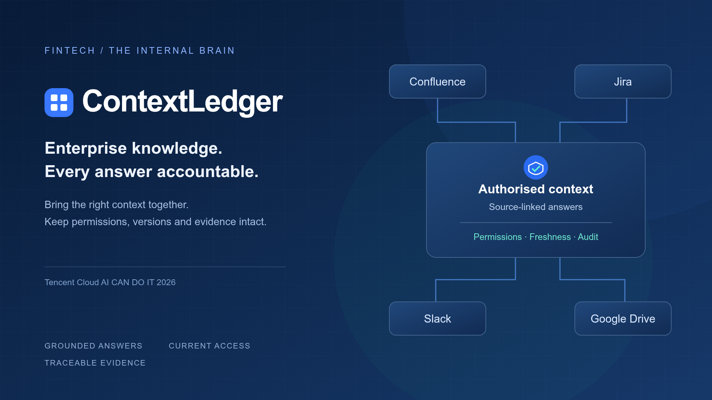
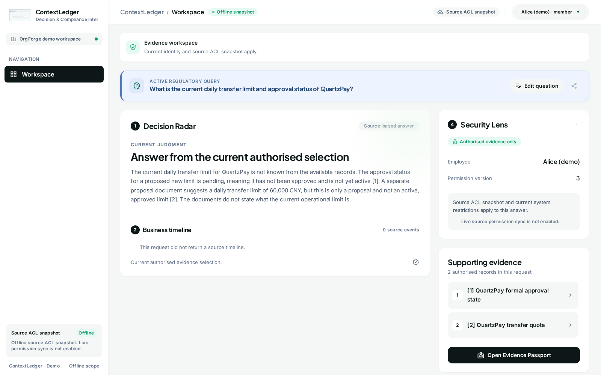
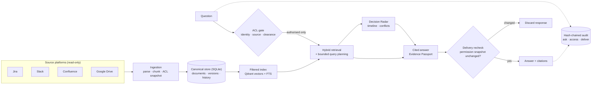

<div align="center">



# ContextLedger

**Enterprise answers with permissions, freshness, and traceable evidence.**

Permission-aware enterprise knowledge assistant — built for the
**Tencent Cloud “AI CAN DO IT” Hackathon Singapore 2026, FinTech track**.

[](https://github.com/Panyuxiang0830/Hackson_fintech/actions/workflows/ci.yml)
[](https://www.python.org/)
[](QUICKSTART.md)

[Quick start](#-quick-start) · [Architecture](#-architecture) · [Evaluation](#-evaluation-highlights) ·
[Submission report](docs/submission/main.tex) · [Document map](docs/README.md)

</div>

---

An employee investigating an incident needs a Jira ticket, a Slack discussion
and a current runbook to answer *one* question. Those records live in four
platforms, each with its own permissions and update times. ContextLedger
searches only the records that employee is authorised to read, answers with
source citations, and logs every request into a tamper-evident audit trail.



## ✨ Three product innovations

| Feature | What it does |
| --- | --- |
| 🎯 **Decision Radar** | Follows how a business conclusion forms. Assembles related tickets, discussions and document revisions into a timeline, separates recorded facts from reported claims, and flags unresolved confirmation conditions (e.g. “Slack says recovered; the incident is still open; monitoring validation is missing → recovery is *not yet confirmed*”). |
| 🔒 **Security Lens** | Makes permission changes visible and immediate. When an administrator revokes access, the affected evidence stops reaching search results, model input, answers and source views — including in-flight responses, which are discarded if their permission snapshot changes. |
| 🛂 **Evidence Passport** | Lets the reader inspect the basis of an answer: the exact authorised records, versions and citations behind it, so every claim can be traced back to its source. |

## 📋 The five required scenarios

1. **Unified natural-language query** across Jira, Slack, Confluence and Google Drive records.
2. **Data freshness** — document updates are re-indexed and safely published; answers use the new version.
3. **Permission enforcement without a metadata side-channel** — unauthorised content (and its existence) never leaks.
4. **Live permission change handling** — revocation takes effect immediately, everywhere.
5. **Audit inquiry** — compliance can reconstruct who asked, accessed and received what, and verify the hash chain.

## 📊 Evaluation highlights

Controlled evaluation on public synthetic corpora (15 October 2026 run;
[full metrics](docs/submission/evaluation/metrics.json),
[method & limits](docs/evaluation/submission-20261015.md)):

| Check | Result |
| --- | --- |
| Permission enforcement | **918 / 918** checks correct — 0 false allows, 0 false denials |
| Freshness | 54 / 54 updates published, **0 stale slots** in 378 queries, ready in p95 ≈ 137 ms |
| Retrieval corpus | 39,414 EnterpriseRAG-Bench documents (572k chunks) + 4,086 OrgForge documents |
| Audit chain | Hash-chained, verified valid after every run |

> These are reproducible prototype measurements on imported/synthetic
> snapshots — not production or unseen-test claims. See
> [verification boundaries](#-honest-boundaries).

## 🚀 Quick start

Requires Linux x86_64 (AVX2), Python 3.10+, Git and a C++17/OpenMP compiler.

```bash
git clone https://github.com/Panyuxiang0830/Hackson_fintech.git
cd Hackson_fintech

python3 -m venv .venv
.venv/bin/pip install -r requirements.txt

# Offline data + model setup, then launch
bash scripts/part_a.sh setup
bash scripts/part_a.sh            # open http://127.0.0.1:7860
bash scripts/integration.sh --help # unified service commands
```

- Offline setup details → [Part A Quick Start](QUICKSTART.md)
- Qdrant publication & unified service → [unified setup](docs/architecture/unified-integration.md)
- Isolated demo accounts (1 administrator + 6 employees) → [demo acceptance](docs/product/demo-acceptance.md)
- Benchmarks → [Benchmark Quick Start](BENCHMARK_QUICKSTART.md)
- MCP tools & source adapters → [source / agent interfaces](docs/architecture/source-and-agent-interfaces.md)

> The loopback-only demo is explicitly enabled and is **not** production
> authentication; ordinary unauthenticated APIs remain locked, and
> identity/permission checks are never removed.

## 🏗️ Architecture

ACL filtering happens **before** retrieval, and permissions are re-checked
again at answer delivery — unauthorised evidence never reaches the model.



**Code map** — business code lives in `contextledger/`, grouped by function
([module map & rationale](docs/architecture/functional-packages.md) ·
[architecture index](docs/architecture/README.md)):

| Package | Responsibility |
| --- | --- |
| `application` | Orchestrates search, answering, source views and audit behind permission/version gates |
| `access` | Persistent identities, source ACLs, local restrictions, revocation, tool credentials |
| `ingestion` | Offline import and opt-in read-only Jira / Slack / Confluence / Drive adapters, parsing, chunking |
| `storage` | SQLite canonical records, version history, document-update jobs, checked index publication |
| `retrieval` | ACL-first hybrid retrieval — filtered Qdrant + FTS (offline Part A: FTS/RaBitQ) |
| `answering` | Prompts, cited answers, citation-scope checks, safe zero-evidence responses |
| `radar` | Decision Radar: entity expansion, timeline/conflict candidates, provenance |
| `audit` | Transactional hash-chained audit, deterministic + natural-language compliance queries |
| `interfaces` | Web frontend, tool API, MCP server (private search/fetch for host agents), CLI |
| `evaluation` | Retrieval scoring, freshness replay, latency measurement — never changes online ranking |

Repository layout:

```text
contextledger/   # service code, by function (see table above)
scripts/         # thin CLI entries & operations tools
tests/           # tests mirroring the functional areas
fixtures/        # fixed business cases with known-correct access decisions
frontend/        # current Stitch frontend (+ dated legacy backup)
docs/            # architecture · decisions (ADRs) · product · evaluation · submission
project/         # requirements ledger (single source of truth)
```

Host-model answers are the tool default; internal GLM/OpenAI-compatible
generation is separately opt-in (`glm-5.3-flash` by default). Failed or
unsafe model output is never presented as a successful answer.

## 🧪 Test

```bash
.venv/bin/python -m pip install -r requirements-integration.txt -r requirements-part-a-test.txt -r requirements-tools.txt
.venv/bin/python scripts/project_sync.py --check
.venv/bin/python -m unittest discover -s tests -v
.venv/bin/python -m pytest tests -q
node --check contextledger/interfaces/static/unified.js

# Tamper-evidence demo (temporary database, not runtime audit state)
.venv/bin/python scripts/demo_audit_tamper.py
```

## 📚 Documentation

| Start here | Then |
| --- | --- |
| [Architecture index](docs/architecture/README.md) — every design doc, grouped by concern | [ADRs](docs/decisions/) — why the hard-to-reverse choices were made |
| [Submission report](docs/submission/main.tex) — the 19-page English report | [Evaluation records](docs/evaluation/) — measurements & protocols |
| [Document map](docs/README.md) — the full project map (中文) | [Requirements ledger](project/requirements.json) — status of REQ-001…020 |

## ⚖️ Honest boundaries

Local regressions cover in-memory Qdrant, permissions, updates, audit and a
real stdio MCP handshake. They do **not** prove live four-platform ACL
completeness, enterprise identity integration, real-source timing,
unseen-case answer quality or production performance. Source ACL mappings
are verified subsets, not complete enterprise permission synchronisation.
Citation-scope checks are not claim-by-claim factual verification. The audit
checkpoint is local, not externally immutable. Browser OIDC is deferred and
disabled by default.

Datasets: [EnterpriseRAG-Bench](https://github.com/onyx-dot-app/EnterpriseRAG-Bench)
(`69916e3`) · [OrgForge](https://github.com/tenurehq/orgforge) (`f2a1ab2`) ·
own synthetic fixtures for permission/freshness checks.

## 🤝 Project management

This Git repository is the single source of truth — see the
[contribution workflow](CONTRIBUTING.md) and [collaboration rules](AGENTS.md).
After changing `project/requirements.json`:

```bash
python3 scripts/project_sync.py
python3 scripts/project_sync.py --check
```

<div align="center">

Built by the **ContextLedger team** for Tencent Cloud “AI CAN DO IT” 2026 · FinTech track

</div>
