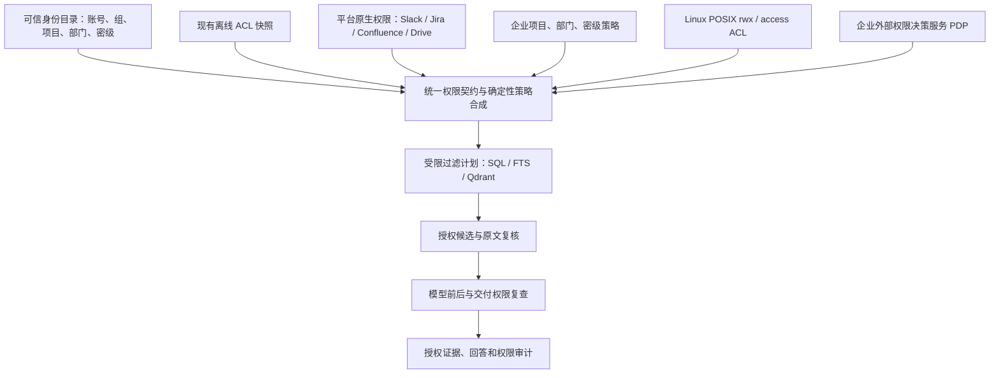

# 多模式确定性权限接入接口 v2

- 日期：2026-10-15。
- 性质：接口与接入方案；新增统一契约、POSIX 和外部 PDP 尚未实现或启用。
- 关联：REQ-003/permission_provider_contract_v2、REQ-016、REQ-002、REQ-005、REQ-017。
- 当前数据：OrgForge 等导入语料继续使用现有 ACL、身份映射和本地撤权；本次不修改数据、索引、服务器或模型配置。
- 决策提案：[ADR-0007](../decisions/ADR-0007-permission-provider-contract.md)。

## 1. 目标与基本判断

权限可以直接来自企业已有的系统、身份目录、项目成员表、安全标签和文件系统，不要求 LLM 从正文推断。公共测试集缺少项目、密级或原生权限，不能据此认定真实企业无法提供这些信息；同样，不能假定每个企业来源都包含完整属性，应由接口报告覆盖范围和缺失状态。

本方案把两项职责分开：

1. 权限提供方读取既有授权依据，保留原始语义、身份命名空间、观察时间和版本。
2. 统一执行层将这些依据转为检索前条件，执行本地撤权、原文复核和交付检查。

LLM 不参与授权必经路径。不从正文中出现的姓名、项目名或“公开”字样自动授予权限。本方案不新增模型分类工作流。



图中表示可选接入位置；不是五种提供方全部已上线。每个资源选择明确的主授权依据，必要的叠加限制必须同时满足。

## 2. 五种接入模式及当前状态

| 模式 | 授权依据 | 接入的数据/接口 | 当前实现与本次范围 |
|---|---|---|---|
| `snapshot_acl` | 导入时保存的每文档允许名单、来源身份映射 | 既有 `acl_json` / `cl_acl`；未来可信 ACL 导出文件 | 现有数据集已经使用；本次原样保留。统一 v2 包装为设计 |
| `native_acl` | 平台当前可观察的资源权限、成员、继承关系 | Slack、Jira Cloud、Confluence Cloud、Drive 只读权限 API | 已有四来源受限适配器及受控测试；真实企业租户全链路待验证，不称为完整平台支持 |
| `attribute_policy` | 企业确认的项目成员、允许部门、角色、密级策略 | 企业目录/API、版本化策略文件、可信导出或管理员配置 | 已有部分字段和过滤条件；统一目录同步、策略编译和管理流程为新设计，原 OrgForge 未填项目/密级分层；随后获准的四份人工演示资料配置单独记录，未推广全库 |
| `posix_acl` | 源服务器的 UID/GID、权限位和访问 ACL | 源端可信采集器读取 stat、路径和 access ACL | 新设计；本次不实现系统调用适配器、不修改服务器文件权限 |
| `external_pdp` | 企业已有权限决策服务的决定 | 固定受信地址的 check + 可过滤资源范围接口 | 新设计；不安装或配置 OPA 等引擎，不声称已集成 |

已有实现依据：`contextledger/ingestion/source_adapters.py`、`source_sync.py`，`contextledger/access/identity_store.py`，`contextledger/retrieval/filtered_index.py`，`contextledger/storage/document_updates.py`。来源适配的具体支持子集继续以[现有说明](source-and-agent-interfaces.md)及 ADR-0005 为准。

## 3. 授权依据如何组合

### 3.1 一种主依据，多个必须满足的限制

每个接入范围配置 `primary_authority`：例如现有 OrgForge 用 `snapshot_acl`，文件服务器用 `posix_acl`，企业项目知识库也可明确使用 `attribute_policy` 作为主授权来源。属性策略成为主依据时，必须有资源负责方批准的版本化策略；存在原生来源限制时，该限制仍是必须满足的上限。

业务读取允许条件：

```text
可信且启用的员工身份
AND 同租户、身份映射及权限依据有效
AND 资源主授权依据明确允许
AND 所有配置为 mandatory 的属性/企业规则允许
AND 没有适用的系统内拒绝规则
AND 当前内容、索引与权限代次可核对
```

主依据内部按其原生算法计算。跨提供方不能随意取并集：例如 POSIX 拒绝时，不能因为项目标签匹配而放行。某主依据失败时也不能自动切换到另一种较宽依据。

同一原生系统允许多个合法组授予读取权时，由该适配器保留其授权语义；不要先把原生 allow/deny、继承或 ACL mask 丢掉，再对名单做简单并集。

### 3.2 数据集目录与内容读取

数据集目录可见性读取已确认的所属关系，独立于内容许可。内容撤权后保留可选入口；搜索、问答、原文继续从后端当前权限得出结果。目录可见不意味着可以枚举标题、链接或文档数量。

### 3.3 属性不是天然的授权

- `owner_department` 说明谁负责；`allowed_department_ids` 才表达允许哪些部门。不能把两者混为一谈。
- `project_ids` 说明资源归属；员工项目成员关系来自可信目录。正文提及某项目不构成项目成员证明。
- `classification` 来自企业批准的标签体系；员工 `clearance` 来自身份或安全管理。等级比较依照已配置顺序，不依赖字符串排序。
- 适配器可以继承来源空间、项目或受管目录的策略。继承是显式配置，不能通过目录名称自动猜测敏感级别。
- 只有被明确配置为非适用的约束才可跳过。缺失的必需属性、查不到的成员关系和不完整的权限分页均不能解释成“无限制”。

## 4. 统一契约草案

以下为设计数据结构和服务端方法，不是已注册 HTTP 路由或已实现 Python Protocol。

### 4.1 SubjectSnapshot：可信员工属性

```json
{
  "schema_version": "permission-v2",
  "tenant_id": "demo-company",
  "subject_id": "employee:1007",
  "identity_revision": "directory:42",
  "active": true,
  "group_ids": ["group:payments-dev"],
  "project_ids": ["project:payments"],
  "department_ids": ["dept:engineering"],
  "clearance": "confidential",
  "native_identities": {
    "slack:workspace-a": "U_EXAMPLE",
    "posix:fileserver-a": {"uid": 1201, "gid": 2100, "supplementary_gids": [2101]}
  },
  "observed_at": "2026-10-15T12:00:00Z",
  "expires_at": "2026-10-15T12:05:00Z"
}
```

字段由可信目录/服务端填写，不接受普通用户或模型自报。POSIX UID 只能在其服务器、挂载和身份命名空间内解释。目录只能更新获授权的属性，不因上传身份快照而获得修改应用管理员角色的能力。

### 4.2 ResourcePolicySnapshot：资源权限依据

```json
{
  "schema_version": "permission-v2",
  "tenant_id": "demo-company",
  "resource_id": "fileserver-a:inode-example",
  "resource_revision": "content:91",
  "provider_id": "fileserver-a-posix",
  "mode": "posix_acl",
  "primary_authority": true,
  "permission_revision": "acl:28",
  "policy_revision": "enterprise-policy:6",
  "parent_policy_revisions": ["directory:12"],
  "observed_at": "2026-10-15T12:00:00Z",
  "expires_at": "2026-10-15T12:05:00Z",
  "status": "ready",
  "complete": true,
  "allowed_actions": ["read"],
  "attributes": {
    "project_ids": ["project:payments"],
    "owner_department_id": "dept:engineering",
    "allowed_department_ids": ["dept:engineering", "dept:product"],
    "classification": "confidential"
  },
  "raw_policy_ref": "private-permission-store:record-28"
}
```

例子中 ready/complete 是假定该采集已完成的示意值，不是当前服务器观测。`raw_policy_ref` 指向服务端受控记录，不允许模型提供任意文件路径/URL作为授权证据。原生 ACL 的类型化细节保存在对应模式的私有记录中，不强迫所有原生规则降级为平面允许名单。

共同字段语义：

| 字段/状态 | 行为 |
|---|---|
| `ready` 且 `complete=true`、版本和时效有效 | 可进入策略计算，不代表自动允许 |
| `unknown` / `unsupported` / `expired` / `complete=false` | 受影响资源禁止参与检索；不泄漏内容；内部审计记录原因 |
| 已验证的空允许集合 | 明确拒绝；与“没有取到允许集合”区分 |
| `expires_at=null` | 只允许显式配置的冻结离线基线；不能由空值推断实时有效 |
| `not_applicable` 的属性约束 | 只能由受信配置指定；与 unknown、空名单区分 |

### 4.3 PermissionProvider：提供方能力

设计方法：

```text
capabilities() -> {modes, actions, visibility_strategy, consistency, limitations}
refresh(scope, cursor) -> PermissionBatch(snapshots, tombstones, complete, revision)
build_visibility(subject_snapshot, query_scope) -> VisibilityPlan
check(subject_snapshot, resource_ref, action="read") -> PermissionDecision
```

`PermissionDecision` 至少包含 `allow|deny|unknown|unsupported`、主体/资源/策略版本、检查时间、决定有效期、供内部审计使用的原因码；只有显式 allow 且所有其他条件通过才交付。普通用户的零证据提示不返回敏感的内部拒绝原因或受限资源标识。

`VisibilityPlan` 至少绑定 tenant、subject、query scope、权限/策略版本、有效期和执行策略。它是服务端编译的受限条件树或有界物化授权集合，不接受原生 SQL 字符串、Qdrant 原始过滤器或任意代码。原生系统状态不能未经校验直接当可执行查询。

允许的检索策略：

1. `compiled_filter`：把受支持的规则确定性转换为 SQL/FTS/Qdrant 同等条件。
2. `materialized_scope`：在检索前生成有界、版本化的可访问资源 ID/组集合，撤权门闩保证旧集合不可继续使用。
3. `unsupported`：如果提供方只能事后检查单篇，且无法生成安全的候选范围，本方案不开放该来源的检索；不能先召回全库，再调用外部接口逐篇过滤冒充前置授权。

### 4.4 可选服务端管理 API

建议未来由 mTLS 服务身份或具备专用能力的操作员访问：

- `POST /internal/v2/identity-snapshots`：可信目录发布身份属性，不自建员工管理员角色。
- `POST /internal/v2/permission-snapshots`：来源发布版本化权限快照和撤销标记。
- `GET /internal/v2/permission-providers/{id}/status`：管理员查看支持范围、失败/过期状态和最近完整观察。
- `POST /internal/v2/permission-checks`：受权管理员进行诊断，按查看权限返回原因；不作为普通用户探测隐藏文档的接口。

上述路径均为提案，当前没有新增这些路由。普通问答、search/fetch、原文入口继续调用统一应用服务，不让模型选择提供方、身份或授权策略。

## 5. 各模式的具体处理

### 5.1 snapshot_acl：保持当前数据

现有语料继续以导入文档 ACL、当前来源身份绑定和本地拒绝规则作依据。保留其 `acl_basis`，例如 OrgForge 的频道/部门推断，不能包装成实时平台验证。将来接入 v2 时必须做兼容回放，未完成前不替换现有路径。版本更新不清空账号、撤权和审计。

### 5.2 native_acl：Slack 及其他平台

演示继续只向管理员提供“是否允许访问 Slack”的开关；底层来源记录的既有 ACL 保持生效，不在这轮增加频道/人物授权界面。

真实 Slack 接入时，绑定稳定 workspace/user/channel ID，使用完整成员分页和用户状态，线程继承所在会话策略；来源范围失败就不发布有效快照，不从发言人姓名或文本提及推权限。现有 SlackAdapter 实现保守的“已映射、未停用的当前成员”子集；它不是公共频道全工作区可见性的完整复刻。DM、群聊、Slack Connect 等会话类型需分别声明和测试，不由读取接口的存在推定已支持；附件作为独立资源另验授权。[Slack 成员 API](https://docs.slack.dev/reference/methods/conversations.members/)

Jira、Confluence、Drive 复用已有来源检查，继续保留工单级限制、空间/页面约束或文件权限的支持边界。企业组、继承、分享链接等不能在不支持时静默当作公开。

### 5.3 attribute_policy：项目、部门、角色、密级

建议从 HR/身份目录提供部门和组，从项目系统提供项目成员，从文档管理系统/批准的受管目录提供资源标签，从安全管理提供员工密级上限。允许通过版本化 JSON/CSV 导出接入，但文件必须由可信发布端生成和验证，普通用户上传的属性不能直接提权。

示例策略（企业自行批准，不是通用公司规则）：

```text
资源属于 payments 项目
AND 员工为 payments 项目成员
AND 员工至少一个部门在该资源允许部门集合内
AND 员工 clearance >= 资源 classification
```

以上配置为 AND；“任一项目可读”和“必须属于所有关联项目”必须分别声明，不能隐含选择。部门允许列表为空表示无人可读，缺失必需标签表示 unknown；需要公司共享的资料由明确的共享策略表达。拥有较高密级本身不授予项目或来源访问权。

此模式既可作为企业明确指定的主授权来源，也可叠加在 native/POSIX 权限上收紧范围。现有 `project` 是单值字段、员工项目列表为空时跳过该过滤；不能直接声称已实现上述必需成员和多项目语义。未来须同时升级属性存储、缺失语义、SQL/Qdrant 条件和测试；未迁移的资源保留原快照模式。

### 5.4 posix_acl：服务器 rwx 和访问 ACL

源端采集器读取员工对应的 UID、主/附加 GID、文件 owner/group/mode、access ACL及路径各级目录权限，以读取为操作。文件需要有效读取权限；路径各级目录需要 search/execute 权限，不能只检查文件最后三位。文件 `x` 不代表可读，`w` 不授予本系统写入能力。扩展 access ACL 必须按 owner、named user、组及 ACL mask 的原生规则处理；默认 ACL 是创建时继承模板，不是每次访问时额外施加的父目录访问名单。[路径解析](https://man7.org/linux/man-pages/man7/path_resolution.7.html)／[Linux ACL](https://man7.org/linux/man-pages/man5/acl.5.html)

设计约束：

- 解析源端身份命名空间，禁止把不同服务器的同号 UID 当成同一员工，也不使用采集器/root 的可读能力代替员工权限。
- 导出文件若丢失了原 UID/GID、路径链或 access ACL，导出副本上的新 mode 不能冒充原服务器权限。
- 文件对象和路径版本绑定，防止替换、符号链接越界与检查后读取对象变化；实施时需文件描述符及受管根目录约束。
- 第一版范围为经过验证的 Linux POSIX DAC/access ACL。涉及 SELinux/AppArmor、capabilities、NFSv4/SMB ACL或其他附加控制时，必须由可验证这些限制的源端检查器处理；无法确认就 unsupported，不能把 DAC 允许称为完整内核授权。

示例：`/srv/projects/payments/plan.md` 为 owner=1201、group=2100、mode=0640，员工属于2100组且路径各级目录均允许搜索时，可获得 DAC 读取许可；任一目录不可搜索则拒绝。`project=payments` 和密级仍需另外的可信标签/目录策略，不能仅凭0640推导。若以 xattr 传递企业标签，必须校验其写入权和权威来源，员工可自行修改的标签不能直接用于扩大读取权。

### 5.5 external_pdp：外部权限决策服务

接入企业已有的 PDP（Policy Decision Point），例如经过配置的企业授权服务或 OPA。服务地址、策略入口、调用身份和超时由管理员固定；只发送必要的主体标识、资源属性、动作和版本，不默认传业务正文。[OPA REST API](https://www.openpolicyagent.org/docs/rest-api)

外部接口必须显式返回允许决定及版本/有效期；HTTP 200 本身不代表允许，缺失结果或无法核对的版本为 unknown。还须提供可验证的检索前过滤条件或有界授权范围。不能假定 OPA 任意策略都能自动转换成当前 SQL/Qdrant 条件。

## 6. 刷新、撤权与存储发布

权限快照不是实时保证。provider 应声明轮询/事件订阅方式、TTL、覆盖范围和最后成功检查时间；没有来源事件时，只能保证配置窗口内或已知快照的撤权处理。

系统内撤权先持久化并增加当前权限版本，立即阻断后续读取。来源权限变更先阻断受影响资源/来源范围，再安全发布新权限数据和过滤条件；旧允许结果不能在异步索引更新时继续生效。保留现有 live 来源故障隔离，不能因单来源故障锁住全部静态语料或放宽该来源。

SQL/FTS、Qdrant、原文读取、Radar扩展、模型上下文和HTTP交付使用相同政策代次。外部目录/策略变化也须使关联的旧决定、缓存和物化授权范围失效，而不只是用户本地 epoch 变化。

组合摘要/聚合证据不得扩大原资源范围；分块继承文档策略。跨资源产物只有请求者对所有使用的原资源均有权时才交付。已交付到员工设备的内容无法追回。

## 7. 后续验收矩阵（尚未执行的新模式测试）

| 测试组 | 主要正反例 |
|---|---|
| 快照兼容 | 相同OrgForge用户/问题与当前证据集合相同；撤权后数据集仍可选；身份与审计不丢失 |
| 原生平台 | 分页完整/不完整、用户停用、频道移除、资源继承、未知会话类型、附件单独授权 |
| 属性策略 | 同项目不同部门、跨项目、同部门无项目成员、密级不足/足够、缺失标签、空集合、多人多项目组合 |
| POSIX | owner/group/other、附加组、named user及mask、父目录无x、文件有x无r、采集器root、UID冲突、路径替换、导出丢失ACL |
| 外部PDP | 显式allow/deny、200缺结果、超时、版本变化、无法形成前置候选范围、旧缓存失效 |
| 共同行为 | 多模式不得越权取并集、缺失主依据不回退、生成期间撤权、SQL/Qdrant一致、普通用户看不到敏感拒绝原因 |

建议使用隔离合成资源和真实本地索引引擎构造确定性真值。真实平台/文件服务器联调独立报告。新模式测试未执行，不计入现有373/381项回归或历史评测分母。

## 8. 报告可用表述

### 中文

ContextLedger 的权限解析不依赖大语言模型。当前原型执行导入的文档级 ACL 和系统内撤权，并已有受限范围的平台原生权限读取适配器。为企业部署，我们进一步设计了统一权限接入契约，覆盖离线 ACL、平台原生权限、项目/部门/密级策略、Linux POSIX 权限与访问 ACL，以及外部权限决策服务。各类权限依据在服务端转换为检索前约束，并保留身份映射、版本和时效信息。此次演示仍沿用原数据集 ACL；新增统一契约、POSIX 和外部决策服务属于设计扩展，尚未完成实现或企业环境验证。

### English

Permission parsing in ContextLedger does not require an LLM. The current prototype enforces imported document ACLs and system-local revocation, and includes bounded native-platform permission readers. For enterprise integration, we define a unified permission-provider contract covering offline ACLs, native platform permissions, project/department/classification policies, Linux POSIX permissions and access ACLs, and external policy decision services. The design preserves identity mappings, policy revisions and observation validity, and requires authorisation before retrieval. The demonstration retains the existing dataset ACLs. The unified contract, POSIX provider and external decision-service provider are design extensions; they have not been implemented or validated in an enterprise environment.

不写“已支持所有企业权限系统”“已完成Linux文件权限集成”“已在OrgForge验证项目和密级分层”或“实时同步原平台撤权”。增加一份方案不自动增加上线能力或评测成绩。

## 9. 本轮交付核验

本轮仅变更架构方案、Proposed ADR、文档入口、需求台账及Changelog。两段JSON示例和本地文档链接检查通过，需求同步与JS语法检查通过；既有unittest 373项、pytest 381项及149个subtests通过。以上是现有功能回归，不是新权限提供方的实现或验收证明。

2026-10-15后续范围更新：用户另行授权仅为ENG-195/PR-135的四份资源配置人工项目/部门/密级，见[演示白名单](../product/curated-demo-permissions.md)。该有限配置不代表统一PermissionProvider或企业属性目录已实现。
