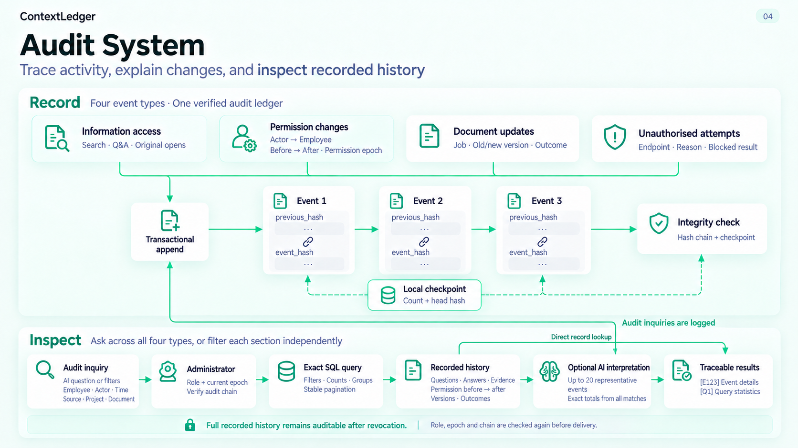

# Audit System v2

2026-10-16；REQ-006/audit_console_four_domains，team_decision。基于当前工作分支82f1673e及用户提供的旧图配色生成全英文新版；本次仅新增图示，不改业务实现或线上权限。使用built-in image_gen；提示词见[prompt.json](prompt.json)，定向修正见[correction-prompt.json](correction-prompt.json)，图片尺寸与哈希见[manifest.json](manifest.json)。

## 实现依据

- contextledger/audit/console.py：四类事件、基于同一验证快照的临时SQLite筛选/计数/分组、稳定分页与分类代表明细。
- contextledger/audit/store.py：事务追加、previous_hash/event_hash、事件计数和头哈希的本地检查点；不是外部锚定或绝对不可篡改。
- contextledger/application/service.py：管理员完整已记录历史视图；模型前后/交付角色、epoch与链复核；审计查询自身继续入链；上限20代表明细与40k字符，统计覆盖完整筛选。
- contextledger/interfaces/static/stitch/app.js：两个主要区域默认展开，资料更新/越权默认折叠；各区独立筛选，E事件和Q1统计引用可打开。
- contextledger/interfaces/web.py、storage/document_updates.py：权限before/after、目标员工和epoch、资料更新任务及版本/结果。

图聚焦管理员工作台，已删除旧图中的管理员业务文档脱敏/版本资格分支；compliance旧流程未扩权。未记录字段不补造；越权尝试不等于确认泄露。

## 图的阅读顺序

上半部分四类事件汇入事务追加，再沿哈希链进入完整性检查；本地检查点保留数量和头哈希。下半部分先检查管理员身份与链，由后端执行完整筛选和精确聚合；可直接查看记录，也可将代表明细与全量统计交给AI解释。E引用对应实际事件、Q1对应本次查询统计。审计查询自身也被记录。

## 验证

以当前工作分支82f1673e为实现基线，图不声称存在外部存证、自动事故归因或实际阅读证明。402项unittest、410项pytest及162项子测试通过；项目同步检查通过；已核对全英文文案、四类事件汇入事务追加、顺序哈希链、本地检查点、管理员完整历史、直接查询分支及可选AI路径。全英文图仅呈现已实现能力，不重启服务或调用审计业务模型。
