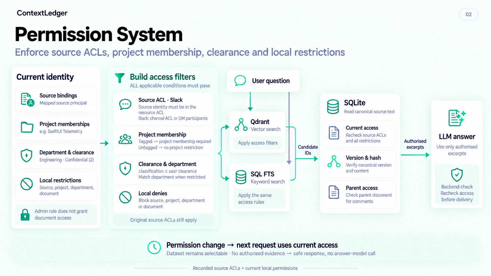

# Permission System — updated presentation diagram

2026-10-16；REQ-016/resource_access_controls，team_decision。基于当前工作分支df566c2c及用户提供的旧英文图编辑，不改业务代码或线上权限。使用built-in image_gen，原始提示词及定向修正分别在prompt.json和correction-prompt.json；PNG已逐项视觉核对。

## 图中语义与实现依据

- 来源身份映射、项目成员、部门/密级和本地拒绝规则是输入；管理员角色不自动获得业务原文权限。见contextledger/access/identity_store.py。
- Slack显示频道ACL和私聊参与人；使用已导入/已记录的ACL，不声称当前演示在实时拉取Slack成员，不通过提及姓名或模型判断授权。OrgForge的ACL由contextledger/access/acl.py编译；Slack导出与受限API适配分别见contextledger/ingestion/supplemental.py、source_adapters.py。
- 有项目标签须具备该项目成员资格；未标项目仅免除项目这一层限制，原来源ACL、密级、部门和本地拒绝仍适用。所有适用约束同时满足。
- 分类等级不得超过员工clearance；存在allowed_departments限制时匹配允许部门，不把文档owning department自动当作所有资料的硬性隔离。
- SQL FTS与Qdrant同时应用权限条件，合并候选ID后读取SQLite标准正文并复核当前访问、版本和哈希；评论需父文档可读。见contextledger/retrieval/filtered_index.py。
- 模型仅接收授权摘录，后端在交付前再查权限；撤权使用最新状态，所属数据集仍可选择，零证据安全提示不调用回答模型。见contextledger/application/service.py、answering/service.py及interfaces/web.py。
- POSIX/rwx、外部PDP、多模式PermissionProvider契约仍是提案，未画为当前实现。

原七图集合位于用户主工作区未提交目录；本次仅在现有工作分支新增独立v2资产，没有改写原PNG或其余六张图。

## 验证

新增规则、关键文案、两路问题输入、权限过滤、候选合并及交付检查已视觉核对。项目同步检查通过；389项unittest通过。本次只新增图示及记录，不改变业务代码或线上权限。
